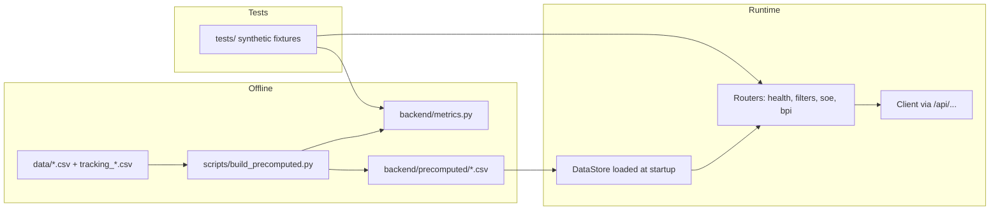

# Design Document

## Overview

The backend has three parts that share one data contract, the three precomputed CSV files.

1. `scripts/build_precomputed.py` (Preprocessor) reads `data/` once, offline, and writes `backend/precomputed/soe_routes.csv`, `play_release_frames.csv` and `bpi_plays.csv`.
2. The FastAPI app in `backend/` loads those files into memory at startup and serves `/health`, `/api/health`, `/api/filters`, `/api/soe/*` and `/api/bpi/summary`.
3. A pytest suite in `tests/` checks pure metric functions with seeded numpy generators and checks endpoints through `fastapi.testclient.TestClient` on small synthetic fixtures.

Key design decisions:

- **Pure core, thin I/O shell.** All metric logic lives in pure functions over pandas DataFrames or numpy arrays (`select_release_frames`, `compute_separation`, `assign_expected_separation`, `flag_likely_targets`, `build_bpi_plays`, `distance_bucket`). File reading and writing wrap them. This makes the logic testable without touching `data/tracking/`.
- **Shared module for logic.** The pure functions live in `backend/metrics.py` so both the script and the tests import them. The script adds the project root to `sys.path` so `from backend.metrics import ...` works when run as `python scripts/build_precomputed.py`.
- **Read-only API over an in-memory store.** The API never recomputes tracking data and never writes to disk, which fits the ephemeral server rule in the project steering file.
- **No new dependencies.** Only FastAPI, Pydantic, pandas, numpy, pytest and httpx at the pinned versions. No hypothesis. Property tests use `numpy.random.default_rng(seed)` with at least 100 iterations.
- **Existing contract preserved.** `backend/main.py` keeps exposing `app` with `GET /health`. The `.env` loader from the steering rules stays at the top of `main.py`.
- **Routes under `/api/...`** except the required root `/health`.

## Architecture



### Repository layout

```
scripts/build_precomputed.py     Preprocessor entry point
backend/
  __init__.py
  main.py                        app, CORS, lifespan, router registration, /health
  config.py                      paths, CORS origins from env
  metrics.py                     pure metric functions (shared with the script)
  store.py                       DataStore: load CSVs once, query helpers
  schemas.py                     Pydantic response models
  routers/
    __init__.py
    health.py  filters.py  soe.py  bpi.py
  precomputed/                   generated CSVs (written by the Preprocessor)
tests/
  conftest.py                    synthetic fixtures, client factory
  test_metrics_properties.py     property tests (numpy, fixed seeds)
  test_store_properties.py       filter / aggregation properties
  test_api.py                    endpoint examples and edge cases
  test_repo_hygiene.py           .gitignore and .env.example checks
.gitignore                       adds data/tracking/ and .env
```

`backend/precomputed/` is committed or generated before deployment, because the server is ephemeral and the API only reads it. The `.gitignore` update is Requirement 7.

## Components and Interfaces

### Preprocessor: `scripts/build_precomputed.py`

```python
REQUIRED_FILES = ["games.csv", "players.csv", "plays.csv", "pffScoutingData.csv"]

def main(data_dir: Path = DATA_DIR, out_dir: Path = PRECOMPUTED_DIR) -> int: ...
def check_inputs(data_dir: Path) -> list[Path]:           # returns missing paths
def process_tracking_file(path: Path, pff: pd.DataFrame, plays: pd.DataFrame,
                          players: pd.DataFrame) -> tuple[pd.DataFrame, pd.DataFrame]:
    """Return (release_rows, route_rows_without_expected) for one tracking file."""
def build_outputs(data_dir: Path) -> tuple[pd.DataFrame, pd.DataFrame, pd.DataFrame]: ...
def write_outputs(out_dir: Path, routes, releases, bpi) -> None: ...
```

Flow of `main`:

1. `check_inputs`. If any required file or the `tracking/` directory is missing or has no `tracking_*.csv`, print each missing path and return exit code 1 (Req 1.3). The script ends with `sys.exit(main())`.
2. Load `plays.csv`, `players.csv`, `pffScoutingData.csv` (small). Read `pff` values `NA` as missing through pandas defaults.
3. For each `tracking_*.csv` in sorted order: read with `usecols=[gameId, playId, nflId, frameId, x, y, event]`, call `process_tracking_file`, keep only the small result frames, then `del` the raw frame (Req 1.4). The file is read once with a single `pd.read_csv` call.
4. Concatenate route rows, then call `assign_expected_separation` over the whole set so the group means use all plays.
5. Build `bpi_plays` from `plays` and `pff` (needs no tracking).
6. `out_dir.mkdir(parents=True, exist_ok=True)` then write the three CSVs with header and `index=False` (Req 1.2, 1.5).

Inside `process_tracking_file`, for each play the function:

- Finds the release frame with `select_release_frames`.
- Joins the frame at `frameId == release` with `pff` roles and `plays` coverage fields.
- Calls `compute_separation` for Route_Players against Coverage_Players.
- Attaches `displayName` from `players`, and `is_likely_target` from `flag_likely_targets`.

### Pure metric functions: `backend/metrics.py`

```python
FALLBACK_MIN_SAMPLES = 15

def select_release_frames(tracking: pd.DataFrame) -> pd.DataFrame:
    """Columns gameId, playId, frameId. One row per play having pass_forward or
    autoevent_passforward. pass_forward wins when both exist. Plays with neither are absent."""

def compute_separation(route_xy: np.ndarray, cover_xy: np.ndarray) -> np.ndarray:
    """route_xy shape (R, 2), cover_xy shape (C, 2). Returns shape (R,) of the minimum
    Euclidean distance to any coverage row. If C == 0 returns an empty array of shape (0,)
    and the caller omits the routes."""

def assign_expected_separation(routes: pd.DataFrame) -> pd.DataFrame:
    """Adds expected_separation and soe. Primary key (pff_passCoverage, pff_positionLinedUp).
    Keys with fewer than 15 samples use (pff_passCoverageType, pff_positionLinedUp)."""

def is_likely_target(display_name: str | None, play_description: str | None) -> bool:
    """Surname is the last whitespace token of display_name, matched case-insensitively
    as a substring of play_description. Empty or missing description gives False."""

def distance_bucket(yards_to_go) -> str | None:
    """Corto 1..3, Medio 4..7, Largo >= 8, None for missing, NaN or < 1."""

def build_bpi_plays(pff: pd.DataFrame, plays: pd.DataFrame) -> pd.DataFrame:
    """One row per play with at least one Pass Rush player. Columns gameId, playId,
    num_rushers, is_pressure, down, yardsToGo, distance_bucket."""
```

Details:

- `compute_separation` uses broadcasting: `d = np.sqrt(((route_xy[:, None, :] - cover_xy[None, :, :]) ** 2).sum(-1))` then `d.min(axis=1)`. It is O(R x C) per play, with R and C at most about 6 and 11.
- Release selection: filter rows with the two events, mark `pass_forward` priority 0 and `autoevent_passforward` priority 1, keep the lowest priority per play, then take that event's `frameId` (the minimum `frameId` if the event repeats on several player rows of the same frame, since all players share the frame).
- `assign_expected_separation` computes the primary group mean and count with `groupby(...).transform`. Rows whose primary count is below 15 take the mean from the fallback group `(pff_passCoverageType, pff_positionLinedUp)`. Then `soe = separation - expected_separation`. A fallback group with zero rows cannot occur because the row itself belongs to it. Rows with a missing coverage key are grouped under pandas default behavior with `dropna=False` so they are not silently lost.
- Zero-mean property boundary: the mean of `soe` is 0 only for groups with 15 or more samples that use the primary key. A fallback group can be mixed with rows from several primary keys, so the zero-mean guarantee is stated for primary groups only, as in Requirement 4.4.
- `is_pressure` is true when any Rusher has `pff_hit`, `pff_hurry` or `pff_sack` equal to 1 (missing values count as not 1).
- `distance_bucket` is applied with `Series.map`. `yardsToGo` is integer-valued in the data. Non-integer values between boundaries (for example 3.5) are floored to the lower bucket by comparing `<= 3`, `<= 7` after the `< 1` check. This choice is a design assumption, since requirements only define integers.

### API: `backend/main.py` and `backend/store.py`

`main.py` keeps the `cargar_env()` block from the steering rules, then:

```python
@asynccontextmanager
async def lifespan(app: FastAPI):
    app.state.store = DataStore.load(PRECOMPUTED_DIR)     # once, Req 15.3
    yield

def create_app(precomputed_dir: Path | None = None) -> FastAPI: ...
app = create_app()
```

`create_app` accepts an optional directory so tests build apps over a temporary directory (synthetic fixtures, or a missing directory for Empty_Result tests). The global `app` uses `PRECOMPUTED_DIR`. CORS uses `CORSMiddleware` with `allow_methods=["GET"]` and origins from the env variable `CORS_ORIGINS` (comma-separated), default `http://localhost:5173,http://localhost:3000` (Req 15.4).

`DataStore`:

```python
class DataStore:
    routes: pd.DataFrame      # soe_routes.csv, empty frame with columns if missing
    releases: pd.DataFrame    # play_release_frames.csv
    bpi: pd.DataFrame         # bpi_plays.csv
    data_loaded: bool         # True only if all three files exist and are readable

    @classmethod
    def load(cls, directory: Path) -> "DataStore": ...
    def filter_routes(self, only_targets, coverage, coverage_type, position) -> pd.DataFrame
    def filter_bpi(self, down, distance_bucket, num_rushers) -> pd.DataFrame
    def filter_values(self) -> dict[str, list]
```

`load` wraps each `read_csv` in try/except for `FileNotFoundError`, `EmptyDataError` and `ParserError` and substitutes an empty frame with the expected columns, so no request path can raise because of a missing file (Req 15.2). Boolean columns are normalized from the strings `True`/`False`. Integer ids are read as `int64`.

Filter semantics: each supplied parameter adds one equality mask, combined with AND. `only_targets=true` adds `is_likely_target == True`. `only_targets=false` or absent applies no filter.

### Endpoints

| Method and path | Query / path params | Response model |
|---|---|---|
| GET `/health` and `/api/health` | none | `HealthResponse {status, data_loaded}` |
| GET `/api/filters` | none | `FiltersResponse` |
| GET `/api/soe/heatmap` | `only_targets`, `coverage`, `coverage_type`, `position` | `HeatmapResponse {cells}` |
| GET `/api/soe/players` | same filters, `min_n` (int, ge 1, default 1), `limit` (1..500, default 50) | `PlayersResponse {players}` |
| GET `/api/soe/plays` | same filters, `limit` (1..500, default 50), `offset` (ge 0, default 0) | `PlaysResponse {total, plays}` |
| GET `/api/soe/play/{game_id}/{play_id}` | `int` path params | `PlayDetailResponse {gameId, playId, frameId, routes}` |
| GET `/api/bpi/summary` | `down`, `distance_bucket`, `num_rushers` | `BpiSummaryResponse` |

Both health paths share one handler function, so their bodies are identical by construction (Req 8.2). `data_loaded` is false when any file is missing (Req 8.3). `/health` is also kept at the root as the AWS contract requires.

Endpoint logic:

- **Filters.** Sorted distinct non-null values: `pff_passCoverage`, `pff_passCoverageType`, `pff_positionLinedUp` from routes, `distance_bucket` and `down` from bpi. Empty lists when the data is empty.
- **Heatmap.** `groupby([pff_passCoverage, pff_positionLinedUp])` over filtered routes, with `mean_soe = mean(soe)` and `n = size`.
- **Players.** `groupby(nflId)` with `displayName = first`, `mean_soe`, `mean_separation`, `n`. Then `n >= min_n`, sort by `mean_soe` descending (ties broken by `nflId` ascending for determinism), then `head(limit)`.
- **Plays.** `groupby([gameId, playId])` with `n_routes`, `mean_soe`, `max_soe`, and `target_soe`. `target_soe` is the mean `soe` over rows with `is_likely_target` true, or null when none (the mean covers the rare case of more than one likely target). Sorted by `gameId`, `playId` ascending so pages are stable. `total` is the group count before slicing, then `iloc[offset:offset+limit]`.
- **Play detail.** Selects routes for the pair. If empty, raise `HTTPException(404, detail="Play not found")`. `frameId` comes from `releases`, or null if missing there. Non-integer path params produce 422 through FastAPI validation.
- **BPI summary.** Filter, then `total_plays = len`, `pressure_rate = sum(is_pressure)/total_plays` (null when zero), and groups by `(num_rushers, distance_bucket)` with `n_plays`, `n_pressure`, `pressure_rate`. Plays with an empty `distance_bucket` are kept in the totals and form groups with `distance_bucket = null` (the groupby uses `dropna=False`).

### Response models: `backend/schemas.py`

```python
class HealthResponse(BaseModel):
    status: str
    data_loaded: bool

class FiltersResponse(BaseModel):
    pff_passCoverage: list[str] = []
    pff_passCoverageType: list[str] = []
    pff_positionLinedUp: list[str] = []
    distance_bucket: list[str] = []
    down: list[int] = []

class HeatmapCell(BaseModel):
    pff_passCoverage: str | None
    pff_positionLinedUp: str | None
    mean_soe: float | None
    n: int

class HeatmapResponse(BaseModel):
    cells: list[HeatmapCell] = []

class PlayerSoe(BaseModel):
    nflId: int; displayName: str | None
    mean_soe: float | None; mean_separation: float | None; n: int

class PlayersResponse(BaseModel):
    players: list[PlayerSoe] = []

class PlaySoe(BaseModel):
    gameId: int; playId: int; n_routes: int
    mean_soe: float | None; max_soe: float | None; target_soe: float | None

class PlaysResponse(BaseModel):
    total: int = 0
    plays: list[PlaySoe] = []

class RouteRow(BaseModel):
    gameId: int; playId: int; nflId: int; displayName: str | None
    pff_positionLinedUp: str | None; pff_passCoverage: str | None
    pff_passCoverageType: str | None
    separation: float | None; expected_separation: float | None; soe: float | None
    is_likely_target: bool

class PlayDetailResponse(BaseModel):
    gameId: int; playId: int; frameId: int | None
    routes: list[RouteRow]

class BpiGroup(BaseModel):
    num_rushers: int; distance_bucket: str | None
    n_plays: int; n_pressure: int; pressure_rate: float | None

class BpiSummaryResponse(BaseModel):
    total_plays: int = 0
    pressure_rate: float | None = None
    groups: list[BpiGroup] = []
```

Float fields are `float | None` so NaN can become null.

## Data Models

Raw inputs (read only): `games.csv`, `players.csv` (`nflId`, `displayName`), `plays.csv` (`gameId`, `playId`, `playDescription`, `down`, `yardsToGo`, `pff_passCoverage`, `pff_passCoverageType`), `pffScoutingData.csv` (`gameId`, `playId`, `nflId`, `pff_role`, `pff_positionLinedUp`, `pff_hit`, `pff_hurry`, `pff_sack`; missing values are `NA`) and `tracking/tracking_*.csv` (`gameId`, `playId`, `nflId`, `frameId`, `x`, `y`, `event`; the string `None` marks frames with no event).

Precomputed outputs:

| File | Columns | Grain |
|---|---|---|
| `play_release_frames.csv` | `gameId`, `playId`, `frameId` | one row per play with a release frame and at least one retained route row |
| `soe_routes.csv` | `gameId`, `playId`, `nflId`, `displayName`, `pff_positionLinedUp`, `pff_passCoverage`, `pff_passCoverageType`, `separation`, `expected_separation`, `soe`, `is_likely_target` | one row per Route_Player per play |
| `bpi_plays.csv` | `gameId`, `playId`, `num_rushers`, `is_pressure`, `down`, `yardsToGo`, `distance_bucket` | one row per play with at least one Rusher |

Requirement 2.3 omits plays with no release event from `play_release_frames.csv`. Requirement 3.3 omits the Route_Players of plays with no tracked Coverage_Player at the release frame from `soe_routes.csv`. The release file keeps those plays because Requirement 2.4 asks for one row per play with a Release_Frame.

Assumption: tracking rows with a null `nflId` (the football) are dropped before role joins, since the football has no `pff_role`.

## Error Handling

| Situation | Behavior |
|---|---|
| Required raw input missing | Preprocessor prints each missing path, returns exit code 1, writes nothing |
| Output directory missing | Preprocessor creates it |
| Play without a release event | Omitted from Release_File and Route_File |
| Play without Coverage_Player at release | Route_Players omitted from Route_File |
| Precomputed file missing, empty or unreadable | `DataStore` substitutes an empty frame. Endpoints return 200 with an Empty_Result. `data_loaded` is false |
| No rows match filters | 200 with empty collections, `total` 0, or null rates |
| `limit`, `offset` or `min_n` out of range, non-integer ids | 422 from FastAPI validation |
| Unknown play on detail endpoint | 404 with `{"detail": ...}` |
| NaN in a numeric column | Converted to `None` before serialization, so JSON has null |
| Bedrock or other optional services | Not used by this feature |

NaN handling: a helper `clean(df)` runs `df.astype(object).where(df.notna(), None)` before building response models. Pydantic models then see `None` rather than `nan`, which keeps the JSON valid (Req 15.5).

## Testing Strategy

The suite uses pytest 8.3.5 and `fastapi.testclient.TestClient` (httpx 0.28.1). It does not use hypothesis. Property tests loop over `numpy.random.default_rng(seed)` with a fixed seed and at least 100 iterations (`N_ITER = 100`). Each failing assertion message includes the seed and iteration index to make it reproducible. Tests never read `data/tracking/`; all data comes from small synthetic frames built in `conftest.py` or inline generators, written to `tmp_path` where an app is needed.

Property tests carry a tag comment of the form `# Feature: soe-bpi-backend, Property N: <title>`.

Unit and example tests cover:

- `/health` and `/api/health` identical bodies (Req 8.1, 8.2, 16.7).
- `data_loaded` false with an empty or missing directory.
- 422 responses for bad `limit`, `offset`, `min_n` and non-integer ids, and 404 for an unknown play.
- CORS default origins and an env override.
- Preprocessor: missing input exits non-zero, output directory creation, Route_File column list, one tiny end-to-end run on synthetic CSVs in `tmp_path`.
- Repository hygiene: `.gitignore` lines and `.env.example` presence.
- Empty_Result for every endpoint with the precomputed files missing (Req 16.6).

Property tests map to the Correctness Properties below. Property-based testing is not used for the I/O wrapper, CORS, repository hygiene or startup-load behavior.

## Correctness Properties

*A property is a characteristic or behavior that should hold true across all valid executions of a system-essentially, a formal statement about what the system should do. Properties serve as the bridge between human-readable specifications and machine-verifiable correctness guarantees.*

### Property 1: Release frame selection

For any tracking table, the release frame chosen for a play is the `pass_forward` frame when one exists, otherwise the `autoevent_passforward` frame, and a play with neither is absent from the result. The result has at most one row per play.

**Validates: Requirements 2.1, 2.2, 2.3, 2.4**

### Property 2: Separation equals brute-force minimum distance

For any set of route positions and any non-empty set of coverage positions, `compute_separation` returns for each route the minimum Euclidean distance computed by an explicit loop, within floating-point tolerance. For any empty coverage set, no separation values are produced.

**Validates: Requirements 3.1, 3.2, 3.3**

### Property 3: Expected separation is the group mean and SOE is zero-mean

For any table of route samples, every row in a primary group `(pff_passCoverage, pff_positionLinedUp)` with 15 or more samples has `expected_separation` equal to the group mean of `separation`, `soe` equals `separation - expected_separation` for every row, and the mean of `soe` within each such group is 0 within 1e-9.

**Validates: Requirements 4.1, 4.3, 4.4**

### Property 4: Small groups fall back to coverage type

For any table of route samples, every row whose primary group has fewer than 15 samples has `expected_separation` equal to the mean `separation` of all rows sharing its `(pff_passCoverageType, pff_positionLinedUp)` key.

**Validates: Requirements 4.2**

### Property 5: Likely target matches surname case-insensitively

For any display name and play description (including empty and missing descriptions), `is_likely_target` is true exactly when the description is non-empty and contains the last whitespace-separated token of the name, ignoring letter case. For any empty or missing description it is false.

**Validates: Requirements 5.1, 5.2, 5.3, 5.4**

### Property 6: BPI play rows match rusher data

For any scouting and plays tables, `build_bpi_plays` returns exactly one row for each play with at least one Rusher, with `num_rushers` equal to the Rusher count and `is_pressure` equal to whether any Rusher has `pff_hit`, `pff_hurry` or `pff_sack` equal to 1.

**Validates: Requirements 6.1, 6.2, 6.5**

### Property 7: Distance bucket boundaries

For any `yardsToGo` value, `distance_bucket` returns `Corto` for 1 to 3, `Medio` for 4 to 7, `Largo` for 8 or more, and an empty value for missing or less than 1. The boundary values 1, 3, 4, 7 and 8 are always included in the generated inputs.

**Validates: Requirements 6.3, 6.4**

### Property 8: Output CSV round trip

For any route, release or BPI table with the declared columns, writing it with the Preprocessor writer and reading it with the `DataStore` reader yields a table with the same header, the same row count and equal values (NaN equal to NaN).

**Validates: Requirements 1.5, 15.5**

### Property 9: Filter values are sorted and distinct

For any routes and BPI tables, each field of `/api/filters` equals the sorted list of distinct non-null values of the matching column.

**Validates: Requirements 9.1**

### Property 10: Heatmap cells match filtered aggregation

For any routes table and any combination of `only_targets`, `coverage`, `coverage_type` and `position`, the heatmap has exactly one cell for each `(pff_passCoverage, pff_positionLinedUp)` pair among rows satisfying every supplied filter, with `mean_soe` and `n` equal to a reference aggregation of those rows. No rows matching gives an empty `cells` list.

**Validates: Requirements 10.1, 10.2, 10.3, 10.4**

### Property 11: Player ranking is sorted, filtered and bounded

For any routes table, filters, `min_n` and `limit` in range, the players response has one entry per `nflId`, sorted by `mean_soe` descending, every entry has `n >= min_n`, the length is at most `limit`, and the filters apply as in Property 10.

**Validates: Requirements 11.1, 11.2, 11.3, 11.5, 11.6**

### Property 12: Play list aggregates and pagination

For any routes table and any in-range `limit` and `offset`, each play entry has `n_routes`, `mean_soe` and `max_soe` equal to the reference aggregates, `target_soe` is null exactly when the play has no Likely_Target, `total` equals the number of matching plays, and concatenating consecutive pages reproduces the full ordered list.

**Validates: Requirements 12.1, 12.2, 12.3, 12.5**

### Property 13: BPI summary rates and filters

For any BPI table and any combination of `down`, `distance_bucket` and `num_rushers`, `total_plays` equals the number of matching plays, the group `n_plays` values sum to `total_plays`, each group `pressure_rate` equals `n_pressure / n_plays` and lies in [0, 1], and the overall `pressure_rate` equals the matching pressure count divided by `total_plays`. With no matching plays, `total_plays` is 0, `pressure_rate` is null and `groups` is empty.

**Validates: Requirements 14.1, 14.2, 14.3, 14.4**

### Property 14: NaN serializes as null

For any numeric table containing NaN values at arbitrary positions, every endpoint response built from it contains valid JSON in which each NaN is null and each non-NaN number is unchanged.

**Validates: Requirements 15.5**

### Property 15: Missing data yields Empty_Result everywhere

For any endpoint in Requirements 8 to 14 and any subset of missing or empty precomputed files, the API responds with status 200 and a body that conforms to the declared schema with empty collections, zero counts or null values, and `/health` reports `data_loaded` false.

**Validates: Requirements 8.3, 9.2, 10.4, 11.6, 12.5, 14.4, 15.2**

### Property 16: Invalid query parameters are rejected

For any `limit` outside 1 to 500, any `offset` below 0 or any `min_n` below 1, the corresponding endpoint responds with status 422, and for any in-range values it does not.

**Validates: Requirements 11.3, 11.4, 12.2, 12.4**
