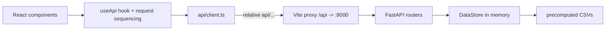

# Design Document

## Overview

The Dashboard is a Spanish, dark-theme React 18 + TypeScript SPA in `hackathon-unam/dashboard`. It reads only from the existing FastAPI backend. The backend receives additive changes only. No new npm or Python dependencies are added, and no endpoint is added.

Decisions on the four open items (verified against `backend/routers/soe.py`, `backend/routers/bpi.py`, `backend/schemas.py`, `backend/store.py` and `scripts/build_precomputed.py`):

| Item | Finding | Decision |
|---|---|---|
| 1. Receiver and nearest-defender coordinates | `GET /api/soe/play/{game_id}/{play_id}` already returns `players` (every non-ball player with `x`, `y`, `pff_role`, `club`), `ball`, `receptor` and `nearest_defender` (`FramePoint` with `x`, `y`, `distance`). `nearest_defender` exists only for the likely target. Every route row already has `separation`, which `backend.metrics.compute_separation` defines as the minimum distance to any Coverage player. | No backend change. The Field_View draws one dotted line per receiver, computed client-side from `players` (Coverage players) and `routes`. The line length label is the route `separation`. |
| 2. Team ranking | `GET /api/bpi/summary` already returns `defense_ranking` (`defensiveTeam`, `n_plays`, `n_pressure`, `pressure_rate`, `mean_rushers`), sorted by `pressure_rate` descending, and already accepts `down`, `distance_bucket`, `num_rushers`, `coverage`, `team`. It lacks yards allowed. | No new endpoint. Extend `BpiDefenseRow` with `mean_yards_allowed` and `bpi`. No new precomputed column (`playResult` is already in `bpi_plays.csv`). |
| 3. `bpi` and `mean_yards_allowed` | `playResult` is already loaded into `store.bpi`. | `bpi = round((pressure_rate * 100) - (mean_yards_allowed * 5), 2)`, `null` when either input is `null`. `pressure_rate` stays a fraction in [0, 1] and `mean_yards_allowed` stays a separate field (mean of non-null `playResult`). Exact shapes below. |
| 4. `/api/soe/plays` | `playDescription` is not in any precomputed CSV. `passResult` and `playResult` are in `bpi_plays.csv`. | Add `playDescription` to `bpi_plays.csv` (one extra column in the preprocessor). Add `playDescription`, `result` and `play_result` to `PlaySoe`. Add the `player` query parameter. |

## Architecture



Frontend layout under `dashboard/src` (TypeScript, Tailwind classes, recharts for the BPI bar chart only):

```
api/client.ts        one function per endpoint, buildUrl, ApiError
api/types.ts         response interfaces
lib/filters.ts       filter state, toQuery, reset
lib/format.ts        yards, percent, dash
lib/kpi.ts           SOE and BPI KPI aggregation
lib/bpi.ts           rusher grouping, DxD matrix, color scales
lib/field.ts         receiver/defender pairing for the field
lib/paging.ts        offset math
hooks/useApi.ts      loading/empty/error state, retry, discard superseded responses
components/          Header, Tabs, MethodologyPanel, FilterBar, KpiCards, Heatmap,
                     ReceiverRanking, PlayList, FieldView, RushersChart, DxdMatrix,
                     TeamRanking, StateViews
```

`vite.config.ts` keeps `base: './'` and adds `server.proxy = { '/api': 'http://localhost:8000' }`.

## Components and Interfaces

### API client (`api/client.ts`)

Every function calls `request(path)` where `path` starts with `api/`. `request` runs `fetch(path)`. On a non-2xx status it throws `ApiError` whose `message` contains the status code and whose `status` field holds it.

```ts
export class ApiError extends Error { constructor(public status: number) { super(`HTTP ${status}`); } }

export function buildUrl(path: string, params: Record<string, string | number | boolean | undefined>): string {
  const qs = new URLSearchParams();
  for (const [k, v] of Object.entries(params)) if (v !== undefined) qs.set(k, String(v));
  const s = qs.toString();
  return s ? `${path}?${s}` : path;
}

export const getFilters  = () => request<FiltersResponse>('api/filters');
export const getHeatmap  = (f: SoeFilters) => request<HeatmapResponse>(buildUrl('api/soe/heatmap', soeQuery(f)));
export const getPlayers  = (f: SoeFilters) => request<PlayersResponse>(buildUrl('api/soe/players', { ...soeQuery(f), limit: 20 }));
export const getPlays    = (f: SoeFilters, player: number | undefined, offset: number) =>
  request<PlaysResponse>(buildUrl('api/soe/plays', { ...soeQuery(f), player, limit: 25, offset }));
export const getPlay     = (g: number, p: number) => request<PlayDetailResponse>(`api/soe/play/${g}/${p}`);
export const getBpiSummary = (f: BpiFilters) => request<BpiSummaryResponse>(buildUrl('api/bpi/summary', bpiQuery(f)));
```

`soeQuery` and `bpiQuery` map filter state to backend parameter names (`coverage`, `coverage_type`, `position`, `only_targets`; `down`, `distance_bucket`, `num_rushers`) and omit any value equal to "Todos" (stored as `undefined`). `only_targets` is sent only when the toggle is on.

The SOE tab calls `getHeatmap`, `getPlayers`, `getPlays`. The BPI tab uses two `getBpiSummary` calls: one with the active BPI filters (KPIs, rushers chart, team ranking) and one without `down` and `distance_bucket` but with `num_rushers` (DxD_Matrix, Requirement 12.6). Both calls use the same function, so no endpoint is added.

### Request state (`hooks/useApi.ts`)

`useApi(fetcher, deps)` returns `{ status: 'loading' | 'empty' | 'error' | 'ready', data, error, retry }`. A monotonically increasing request id is stored in a ref. A response is applied only when its id equals the latest id, so a superseded response is discarded (Requirement 14.6). `retry` re-runs only that hook. `isEmpty(data)` is passed per section by the caller. Sections are independent hooks, so one failure leaves the others interactive.

### Field_View (item 1)

`lib/field.ts`:

```ts
export interface ReceiverLine {
  nflId: number; name: string; isTarget: boolean;
  rx: number; ry: number;           // receiver at release frame
  dx: number | null; dy: number | null;  // nearest Coverage player, null when none
  separation: number | null;        // route.separation (yards)
  expected: number | null; soe: number | null;
}

export function pairReceivers(detail: PlayDetailResponse): ReceiverLine[] {
  const cover = detail.players.filter(p => p.pff_role === 'Coverage' && p.x != null && p.y != null);
  return detail.routes.flatMap(r => {
    const rec = detail.players.find(p => p.nflId === r.nflId);
    if (!rec || rec.x == null || rec.y == null) return [];   // no coordinates: no marker
    let best: FramePoint | null = null, bestD = Infinity;
    for (const c of cover) { const d = Math.hypot(c.x! - rec.x, c.y! - rec.y); if (d < bestD) { bestD = d; best = c; } }
    return [{ nflId: r.nflId, name: r.displayName ?? String(r.nflId), isTarget: r.is_likely_target,
      rx: rec.x, ry: rec.y, dx: best?.x ?? null, dy: best?.y ?? null,
      separation: r.separation, expected: r.expected_separation, soe: r.soe }];
  });
}
```

The line is drawn only when `dx` and `dy` are non-null and is labeled with `separation` (two decimals), which equals the pairing distance by the definition of `compute_separation`. For the likely target the pairing must agree with the backend `nearest_defender`; the component uses the backend value for the target when present (single source) and the client pairing for the other receivers. The SVG uses `viewBox="0 0 120 53.3"`. Backend x and y are already normalized so the offense moves right. Yard lines are drawn every 5 yards from x = 10 to 110, end zones are x in [0,10] and [110,120], hash marks at y = 23.58 and 29.72 (NFL hash width 18.5 ft from center line is approximately 6.17 yards each side of 26.65; implementer may use these constants).

### Play list and receiver selection

State: `selectedReceiver: number | undefined`, `offset`, `selectedPlay`. Clicking a receiver row toggles `selectedReceiver` (`toggle(prev, id) = prev === id ? undefined : id`) and resets `offset` to 0. `getPlays(filters, selectedReceiver, offset)` sends `player` only when defined. Pagination: `nextOffset = offset + 25` enabled when `offset + plays.length < total`; `prevOffset = max(0, offset - 25)`.

### KPI and BPI helpers

`lib/kpi.ts`
- `soeKpis(cells, players)`: `routes = Σ n`; `meanSoe = Σ(n·mean_soe)/Σ n` over cells with non-null `mean_soe` (weight is the `n` of those cells only); `meanSep` likewise with `mean_separation`; `receivers = players.length`. Returns `null` for a value whose weight sum is 0.
- `bpiKpis(summary)`: `total_plays`, `pressure_rate`, `mean_yards_allowed`, `Σ by_rushers.n_pressure`.

`lib/bpi.ts`
- `groupRushers(groups)`: key = `num_rushers >= 6 ? '6+' : String(num_rushers)`; groups with `num_rushers < 3` are excluded from the chart rows; per key sum `n_plays` and `n_pressure`, `rate = n_pressure / n_plays`.
- `buildDxd(down_distance)`: rows downs 1 to 4, columns `Corto|Medio|Largo` displayed as Short, Medium, Long. Cells with `n_plays === 0` are `null` and excluded from the color scale. Each cell carries `bpi` (null when the backend returns null). Cells with `n_plays === 0` or `bpi === null` are `null` for color purposes and excluded from the scale. The cell color comes from `bpiColor(bpi, maxAbs)` with `maxAbs = max(|bpi|)` over non-null cells (see below).

`lib/format.ts`: `fmtYards(v) = v == null ? '—' : v.toFixed(2)`, `fmtPct(v) = v == null ? '—' : (v*100).toFixed(1) + '%'`, `fmtBpi(v) = v == null ? '—' : (v > 0 ? '+' : '') + v.toFixed(2)`.

Heatmap color: `scale(v, maxAbs)` returns a hue by sign (negative: red family, positive: blue family) and intensity `min(1, |v| / maxAbs)`. Zero maps to neutral. Missing cells render neutral without tooltip.

BPI color (`lib/bpi.ts`, pure function, no dependency):

```ts
export interface BpiColor { hue: 'positive' | 'negative' | 'neutral'; intensity: number }  // intensity in [0, 1]
export function bpiColor(bpi: number | null, maxAbs: number): BpiColor | null {
  if (bpi == null) return null;                       // no data: neutral cell, no tooltip
  if (bpi === 0 || maxAbs <= 0) return { hue: 'neutral', intensity: 0 };
  return { hue: bpi > 0 ? 'positive' : 'negative', intensity: Math.min(1, Math.abs(bpi) / maxAbs) };
}
```

The scale is diverging and centered at 0: positive BPI uses the blue family, negative BPI the red family, 0 is neutral. The DxdMatrix legend shows `-maxAbs`, 0 and `+maxAbs`. `DxdMatrix` is the only consumer in this change.

### MethodologyPanel

The panel's BPI section shows the formula `BPI = (tasa de presión × 100) − (yardas permitidas promedio × 5)` and one explanation line (Spanish): "Positivo: la presión compensa las yardas cedidas; negativo: el blitz salió caro." The line is static text.

### BPI display

- Team_Ranking: an added column "BPI" shows `fmtBpi(bpi)`, with positive values in the positive hue and negative values in the negative hue. Row order stays by `pressure_rate` as returned by the backend.
- RushersChart: bars stay on `pressure_rate`. The tooltip adds `BPI` (`fmtBpi`) and `Yardas permitidas` (`fmtYards`) per rusher group. `groupRushers` recomputes the group BPI from summed values, not by averaging `bpi` values: `bpi = round(rate*100 - meanYards*5, 2)`, where `meanYards` is the `n_plays`-weighted mean over members with non-null `mean_yards_allowed`, or null when none.
- DxdMatrix: each cell shows `fmtBpi(bpi)` with `n_plays` in the tooltip, colored by `bpiColor`.
- The BPI Kpi card is not added.

### Team_Ranking (item 2)

Source: `response.defense_ranking` from `GET api/bpi/summary` with the active BPI filters. The frontend sorts by `pressure_rate` descending as returned (backend already orders by rate, then team name). Columns: rank (index + 1), team label, `n_plays`, `pressure_rate` (percent), `mean_yards_allowed` (yards, "—" when null), `bpi` (`fmtBpi`, "—" when null). Empty array shows the Empty_State. The backend uses `groupby("defensiveTeam", dropna=False)`, so plays with a null `defensiveTeam` are not dropped. They appear as one row with `defensiveTeam: null`, ranked by its `pressure_rate` like any other row (the backend sort places it after named teams only on ties). The UI renders a null `defensiveTeam` as the label "Sin equipo" (an empty string is treated the same), and uses a stable React key such as `defensiveTeam ?? '__none__'`.

## Backend additive extensions

All new fields have defaults of `None` in Pydantic, no existing field, parameter or status code changes, and no new endpoint.

### Schemas (`backend/schemas.py`)

```python
class HeatmapCell(BaseModel):
    ...                                  # existing fields unchanged
    mean_separation: float | None = None

class PlayerSoe(BaseModel):
    ...
    team: str | None = None              # receiver's possessionTeam

class PlaySoe(BaseModel):
    ...
    playDescription: str | None = None
    result: str | None = None            # passResult code: C, I, IN, S, R, IR, or None
    play_result: float | None = None     # playResult in yards

class BpiGroup(BaseModel):
    ...
    mean_yards_allowed: float | None = None
    bpi: float | None = None             # round(pressure_rate*100 - mean_yards_allowed*5, 2)
class BpiRushersRow(BaseModel):
    ...
    mean_yards_allowed: float | None = None
    bpi: float | None = None
class BpiDownDistanceCell(BaseModel):
    ...
    mean_yards_allowed: float | None = None
    bpi: float | None = None
class BpiDefenseRow(BaseModel):
    ...
    mean_yards_allowed: float | None = None
    bpi: float | None = None
class BpiSummaryResponse(BaseModel):
    ...
    mean_yards_allowed: float | None = None
```

`FramePoint`, `PlayDetailResponse`, `RouteRow` are unchanged.

### Definitions (item 3)

- `pressure_rate` is unchanged: `n_pressure / n_plays` in [0, 1], `null` when `n_plays == 0`.
- `bpi` (on `BpiGroup`, `BpiRushersRow`, `BpiDownDistanceCell`, `BpiDefenseRow`) is `round((pressure_rate * 100) - (mean_yards_allowed * 5), 2)` computed from the same row's two fields. It is `null` when `pressure_rate` or `mean_yards_allowed` is `null`. The result is unbounded (not limited to [0, 1]); positive means pressure compensated the yards given up, negative means the blitz was costly.
- `mean_yards_allowed` (on `BpiGroup`, `BpiRushersRow`, `BpiDownDistanceCell`, `BpiDefenseRow`, and the summary total) is the arithmetic mean of `playResult` over the plays of that row, ignoring null `playResult`. It is `null` when no play in the row has a `playResult`. In pandas: `float(s.mean())` when `s.notna().any()` else `None`. `playResult` is the offense's net yards on the play (sacks are negative), so it is the yards allowed by the defense.
- The summary early-return for zero plays keeps `total_plays=0`, `pressure_rate=None`, and now `mean_yards_allowed=None`.

Implementation in `bpi_summary`: add `"playResult": df["playResult"].to_numpy()` to `work`; extend `_agg` to also return `mean_yards=("playResult", "mean")` (pandas `mean` skips NaN and yields NaN when all values are NaN, which `_none_if_na` converts to `None`). The rushers, down-distance and defense groupbys get the same aggregation. A helper `_bpi(pressure_rate, mean_yards)` returns `None` if either argument is `None`, else `round(pressure_rate * 100 - mean_yards * 5, 2)`. `mean_yards_allowed=_none_if_na(mean_yards)` and `bpi=_bpi(pressure_rate, mean_yards_allowed)` are set wherever `pressure_rate` is set, using the unrounded `pressure_rate` and `mean_yards_allowed` values.

### `/api/soe/heatmap` and `/api/soe/players`

- Heatmap: add `mean_separation=("separation", "mean")` to the existing `.agg(...)`.
- Players: add `team=("possessionTeam", "first")` to the existing `.agg(...)`. NaN becomes `None` through `clean_records`.

### `/api/soe/plays` (item 4)

New optional query parameter `player: int | None = None` (FastAPI returns 422 for non-integers). After `filter_routes(...)`:

```python
if player is not None:
    keys = df.loc[df["nflId"] == player, ["gameId", "playId"]].drop_duplicates()
    df = df.merge(keys, on=["gameId", "playId"], how="inner")   # keep all routes of those plays
```

The player route row must satisfy the active filters (consistent with the receiver ranking, which uses the same filters). Other routes of the play stay in the aggregation, so `n_routes` and `mean_soe` keep their meaning. When `player` is absent the code path is skipped, so output is identical to today.

Context for the page rows comes from a new `DataStore.play_context(keys)` helper that reads `store.bpi` (one row per play after `drop_duplicates(["gameId","playId"])`) and returns `playDescription`, `passResult` and `playResult` per key. Missing columns or missing plays give `None`. It is applied to the page slice only (at most 500 rows):

```python
page = grouped.iloc[offset: offset + limit]
ctx = store.play_context(page[["gameId", "playId"]])
# merge left on keys, then PlaySoe(**r, playDescription=..., result=passResult, play_result=playResult)
```

### Precomputed columns (item 2 and 4)

`scripts/build_precomputed.py`: add `"playDescription"` to `BPI_EXTRA_COLUMNS`; `plays` already contains it, so `add_bpi_context` appends it to `bpi_plays.csv`. `backend/store.py`: add `"playDescription"` to `BPI_EXTRA_COLUMNS` and `_text(...)` in `_prepare_bpi`. `_read` already fills missing columns with NA, so an old CSV without the column keeps working and returns `null`. Regenerating the precomputed files is needed only to see descriptions. Team ranking needs no new column.

## Data Models

Frontend types (backend models are listed under Backend additive extensions):

```ts
export interface HeatmapCell { pff_passCoverage: string|null; pff_positionLinedUp: string|null; mean_soe: number|null; mean_separation: number|null; n: number }
export interface PlayerSoe { nflId: number; displayName: string|null; team: string|null; mean_soe: number|null; mean_separation: number|null; n: number }
export interface PlaySoe { gameId: number; playId: number; n_routes: number; mean_soe: number|null; max_soe: number|null; target_soe: number|null; playDescription: string|null; result: string|null; play_result: number|null }
export interface FramePoint { nflId: number|null; displayName: string|null; club: string|null; x: number|null; y: number|null; is_ball: boolean; pff_role: string|null; pff_positionLinedUp: string|null; distance: number|null }
export interface BpiDefenseRow { defensiveTeam: string|null; n_plays: number; n_pressure: number; pressure_rate: number|null; mean_rushers: number|null; mean_yards_allowed: number|null; bpi: number|null }  // bpi = round(pressure_rate*100 - mean_yards_allowed*5, 2)
export interface BpiSummaryResponse { total_plays: number; pressure_rate: number|null; mean_yards_allowed: number|null; groups: BpiGroup[]; by_rushers: BpiRushersRow[]; down_distance: BpiDownDistanceCell[]; defense_ranking: BpiDefenseRow[] }
```

Remaining types mirror `backend/schemas.py`. The result code is displayed with a label map `C: Completo, I: Incompleto, IN: Intercepción, S: Sack, R: Corrida` and the raw code for unknown values, followed by `play_result` yards when present.

## Error Handling

- Non-2xx: `ApiError(status)`; the section shows "No se pudieron cargar los datos" with "Reintentar". A 404 from `api/soe/play/...` maps to the Field_View Empty_State "Jugada no encontrada".
- Empty responses show "Sin datos para los filtros seleccionados".
- Each section has its own `useApi`, so failures are isolated. Superseded responses are dropped by request id.
- Backend: `player` non-integer returns 422 through FastAPI validation. Missing data files already produce empty frames, so new fields return `null` and lists return empty.
- Null `team`, `mean_yards_allowed`, `playDescription` and KPI values render as "—".

## Correctness Properties

*A property is a characteristic or behavior that should hold true across all valid executions of a system-essentially, a formal statement about what the system should do. Properties serve as the bridge between human-readable specifications and machine-verifiable correctness guarantees.*

### Property 1: Request URLs are relative

For any endpoint function and any filter or paging input, the URL passed to `fetch` begins with `api/` and does not begin with `/`.

**Validates: Requirements 1.2**

### Property 2: Non-2xx status is reported

For any HTTP status code from 300 to 599, the API_Client rejects with an error whose message contains that status code.

**Validates: Requirements 1.7**

### Property 3: Filter state to query round trip

For any filter state, the query built from it contains exactly the parameters whose value is not "Todos", and parsing the query back yields those values. Resetting any filter state yields the all-"Todos" state with an empty query and no selected receiver.

**Validates: Requirements 5.5, 5.6**

### Property 4: SOE KPIs are n-weighted

For any list of Heatmap_Cells, the KPI route count equals the sum of `n`, and the mean SOE and mean separation equal the `n`-weighted means over cells with a non-null value, or null when no such cell exists.

**Validates: Requirements 6.3, 6.6**

### Property 5: Value formatting

For any number v, `fmtYards(v)` has exactly two decimals and `fmtPct(v)` is `v*100` with one decimal and a percent sign. For null both return "—".

**Validates: Requirements 6.5, 6.6**

### Property 6: Heatmap color scale

For any two non-null values a and b with the same sign and |a| <= |b|, intensity(a) <= intensity(b). For any positive value and any negative value the hues differ.

**Validates: Requirements 7.3**

### Property 7: Receiver selection toggles

For any receiver id and any prior selection, toggling the id twice from an unselected state returns the unselected state, and the plays request includes `player` exactly when a receiver is selected.

**Validates: Requirements 8.4, 8.5, 9.1**

### Property 8: Pagination offsets

For any total, page size 25 and current offset that is a multiple of 25 below total, next offset is offset + 25 and is enabled only when offset + 25 < total, and previous offset is max(0, offset - 25).

**Validates: Requirements 9.3**

### Property 9: Receiver to defender pairing

For any play detail with at least one Coverage player, each receiver line ends at a Coverage player whose distance to the receiver is less than or equal to the distance of every other Coverage player, and that distance equals the route `separation` within 1e-6.

**Validates: Requirements 10.3, 10.4**

### Property 10: Rusher grouping preserves totals

For any list of BPI groups, the grouped rows have keys in {"3","4","5","6+"}, the sum of `n_plays` and `n_pressure` over grouped rows equals the sums over input groups with `num_rushers >= 3`, and each rate equals `n_pressure / n_plays`.

**Validates: Requirements 11.2, 11.5**

### Property 11: Down by distance matrix and BPI color

For any list of down-distance cells, each matrix cell's counts equal the sum of the matching input cells, and cells with zero plays or null `bpi` are empty and absent from the color scale. For any `maxAbs > 0`, `bpiColor(0, maxAbs)` is neutral, a positive value has the positive hue, a negative value has the negative hue, `bpiColor(null, maxAbs)` is null, and for any two values a and b of the same sign with |a| <= |b|, intensity(a) <= intensity(b), with every intensity in [0, 1].

**Validates: Requirements 12.2, 12.3, 12.5**

### Property 12: Superseded responses are discarded

For any sequence of requests that resolve in any order, the displayed data is the response of the most recently issued request.

**Validates: Requirements 14.6**

### Property 13: Heatmap mean_separation

For any routes table and filters, each Heatmap_Cell's `mean_separation` equals the mean of `separation` over the filtered routes of that coverage and position.

**Validates: Requirements 15.1**

### Property 14: BPI formula and mean_yards_allowed

For any BPI table and any filter combination, the summary `mean_yards_allowed`, and the `mean_yards_allowed` of each group, rusher row, down-distance cell and defense row, equal the mean of non-null `playResult` over the matching plays, or null when there is none. For every such row, `pressure_rate` is in [0, 1] or null, and `bpi` equals `round((pressure_rate * 100) - (mean_yards_allowed * 5), 2)` when both are non-null and is null when either is null.

**Validates: Requirements 15.3, 15.4, 15.9**

### Property 15: Team ranking order

For any BPI table and filters, `defense_ranking` is ordered by `pressure_rate` descending, and its `n_plays` values sum to `total_plays`. Plays with a null `defensiveTeam` are not dropped (`groupby("defensiveTeam", dropna=False)`); they form a single row with a null team, which the UI labels "Sin equipo".

**Validates: Requirements 13.2, 13.3**

### Property 16: Player filter on plays

For any routes table, filters and `nflId` p, every play returned by `/api/soe/plays?player=p` has a route row for p matching the filters, no play with such a row is omitted from the full set (before paging), and omitting `player` returns the same plays as the pre-extension implementation.

**Validates: Requirements 15.6, 15.7, 15.8**

### Property 17: Additive compatibility

For any request that the pre-extension API accepted, the response contains every pre-extension field with an unchanged value and the same status code, and new numeric fields are null when they have no source rows.

**Validates: Requirements 15.8, 15.9**

## Testing Strategy

Backend tests use pytest and `TestClient`, as in `backend/tests`. Property tests follow the existing convention: seeded `numpy.random.default_rng`, at least 100 iterations, no hypothesis, tag comment `# Feature: soe-bpi-dashboard, Property N: <title>`. New tests go in `backend/tests/test_dashboard_extensions.py` and cover Properties 13 to 17 plus example tests for `team`, `playDescription`/`result` with and without the column, and 422 for `player=abc`.

The frontend has no test runner and the requirements forbid new dependencies, so Properties 1 to 12 are implemented as pure functions in `lib/` and `api/` that can be tested later with any runner. For now the frontend is checked by `npm run typecheck`. The implementing agent runs no commands, so the final task lists the external CMD commands (regenerate precomputed files, start backend on 8000, start dashboard, run pytest).

`bpiColor`, `fmtBpi` and the rusher-group BPI recomputation are pure functions in `lib/` and are covered by Property 11 (and Property 5 style formatting checks) once a runner exists.

UI rendering (theme, contrast, tabs, ARIA attributes, SVG geometry, tooltips, legends, Spanish text) is verified manually.
